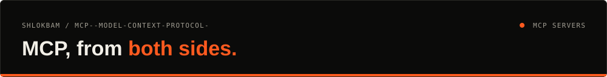
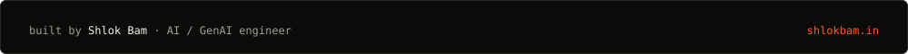

<div align="center">




<a href="#what-it-does">What it does</a> · <a href="#stack">Stack</a> · <a href="#run-it">Run it</a>

</div>

Three small projects that cover the Model Context Protocol from both ends: an expense-tracker MCP server (local and deployed), and an MCP client chatbot that drives someone else's server.

## What it does

| Folder | What it is |
| :--- | :--- |
| [`Expense_Tracker_MCP_Server/`](Expense_Tracker_MCP_Server) | A FastMCP server over SQLite with `add_expense`, `list_expenses` and `summarize` tools and an `expense://categories` resource (20 categories) |
| [`Remote_Server/`](Remote_Server) | The same server rewritten async with `aiosqlite` and deployed over HTTP at `https://remote-server-sb.fastmcp.app/mcp` |
| [`ChatBot/`](ChatBot) | A LangGraph + Mistral chatbot that connects to the [emailmd](https://www.emailmd.dev) MCP server, calls its `render`, `lint` and `read_docs` tools and previews the email it builds |

## Stack

| Area | Tools |
| :--- | :--- |
| Servers | Python 3.14, FastMCP, SQLite / aiosqlite, uv |
| Client | MCP Python SDK, LangChain, LangGraph, Mistral, LangSmith, Streamlit |

## Run it

```bash
# local server, with the MCP inspector
cd Expense_Tracker_MCP_Server && uv run fastmcp dev inspector main.py

# client chatbot (needs MISTRAL_API_KEY)
cd ChatBot && pip install -r requirements.txt && streamlit run app.py
```

To use the local server in Claude Desktop or Cursor, add it to your MCP config:

```json
{
  "mcpServers": {
    "expense-tracker": {
      "command": "uv",
      "args": ["--directory", "/path/to/Expense_Tracker_MCP_Server", "run", "main.py"]
    }
  }
}
```

Or connect any MCP client to the deployed server: `https://remote-server-sb.fastmcp.app/mcp`.

---

<div align="center">

<a href="https://shlokbam.in"></a>

<a href="https://shlokbam.in">shlokbam.in</a> · <a href="https://www.linkedin.com/in/shlokbam/">LinkedIn</a> · <a href="https://github.com/shlokbam">More projects</a>

</div>
